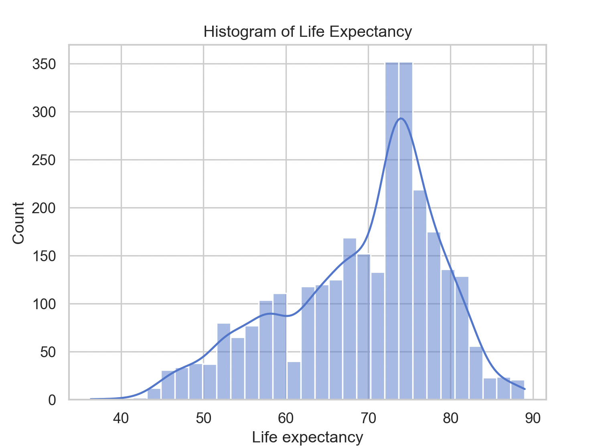
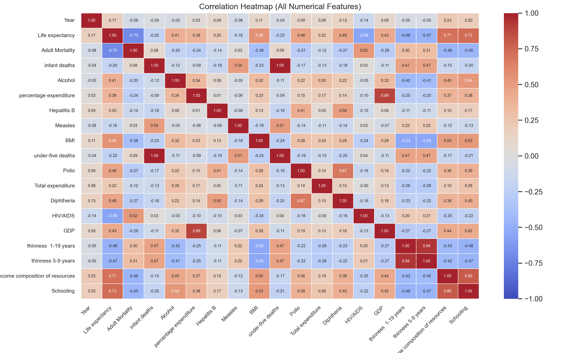
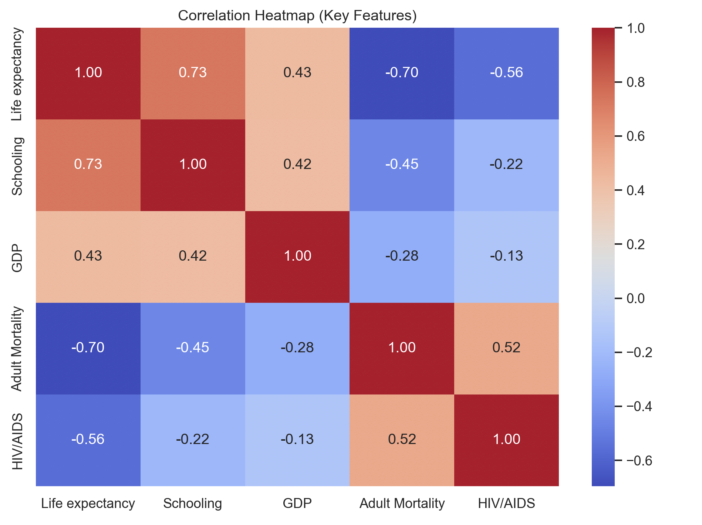
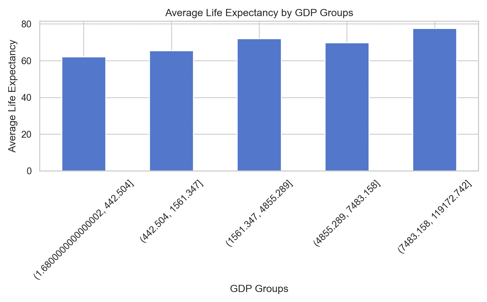
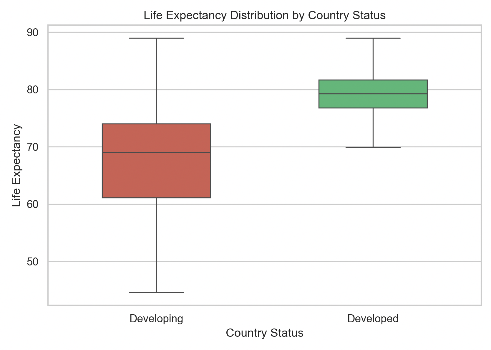
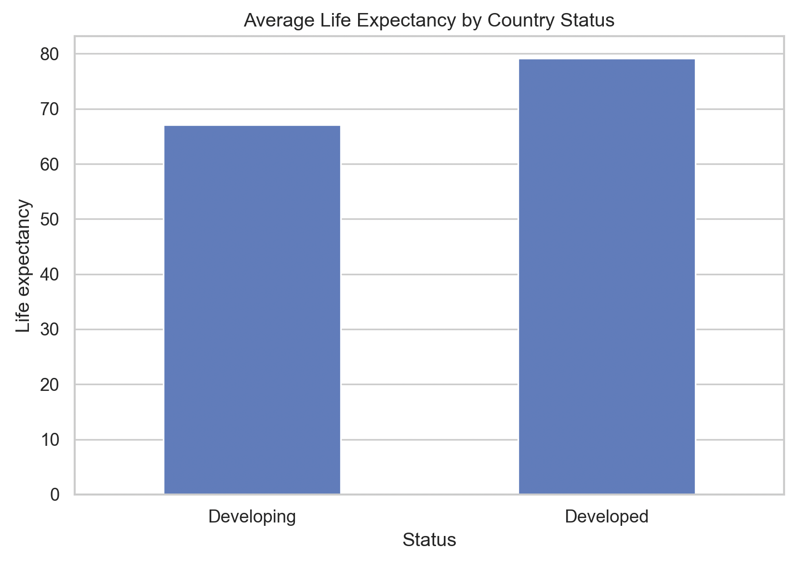
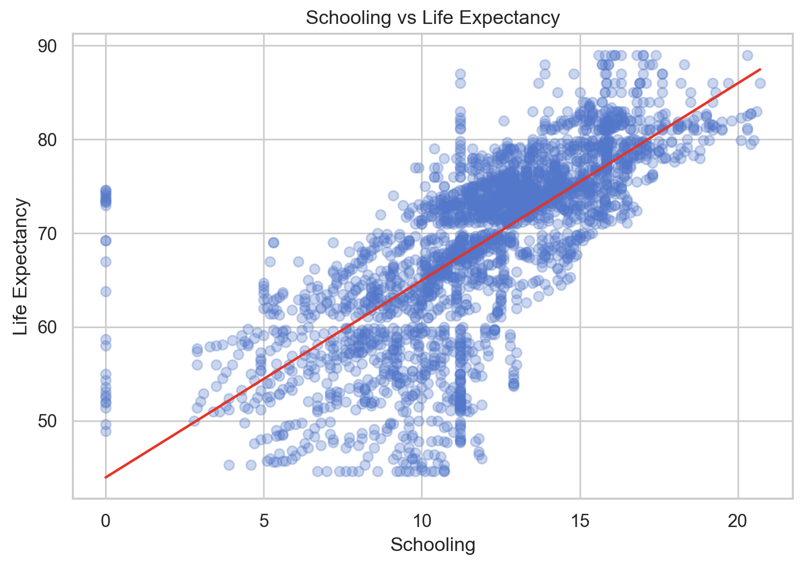
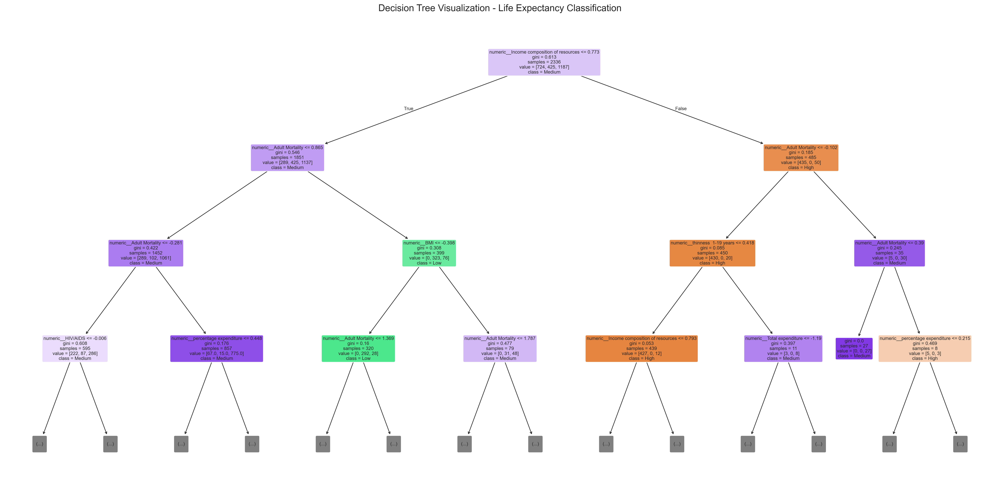

# Life Expectancy Analysis and Machine Learning

[](https://www.python.org/)
[](https://scikit-learn.org/)
[](https://streamlit.io/)

An end-to-end analysis of the WHO Life Expectancy dataset. The project explores country-year health and socioeconomic data, fits a country-aware linear regression, compares four classifiers for life-expectancy categories, and provides an interactive Streamlit dashboard.

> Classification labels and evaluation results are specific to this project and dataset. They are not official WHO categories or causal estimates.

## Project Overview

The data analysis script, [`data.py`](data.py), loads and cleans the WHO dataset, performs exploratory analysis, fits a simple regression model, and evaluates four classification algorithms. The dashboard in [`app.py`](app.py) presents dataset summaries and visual analysis, recalculates the regression, and reads the saved classifier result tables. Classification results are written to CSV files for review and dashboard use.

The repository also contains existing plot images and pre-generated result CSVs. Running `data.py` regenerates the classification result CSVs and the decision-tree image; most EDA plots and confusion matrices are displayed interactively with Matplotlib rather than saved as files.

## Objectives

- Inspect and clean country-year observations from the WHO Life Expectancy dataset.
- Explore distributions, missingness, correlations, GDP groups, and country development status.
- Quantify the association between schooling and life expectancy using linear regression.
- Classify observations into three project-defined life-expectancy bands.
- Compare Decision Tree, KNN, Gaussian Naive Bayes, and Random Forest classifiers.
- Evaluate models with country-grouped holdouts, group-aware cross-validation, and a later-year holdout.
- Present the analysis in an interactive dashboard.

## Dataset Description

The source dataset is the [WHO Life Expectancy dataset on Kaggle](https://www.kaggle.com/datasets/kumarajarshi/life-expectancy-who). The checked-in CSV, `Life Expectancy Data.csv`, has **2,938 rows and 22 columns**, covering **193 countries from 2000 through 2015**. A row represents one country in one year. Columns include life expectancy, mortality, health expenditure, immunization, education, GDP, population, and development status.

The script relies on these exact column names after trimming whitespace: `Life expectancy`, `Country`, and, for the relevant analyses, `Year`, `Schooling`, `GDP`, and `Status`.

## Technologies and Libraries Used

| Technology | Use |
| --- | --- |
| Python | Analysis and dashboard application |
| pandas, NumPy | Data loading, cleaning, feature handling, and calculations |
| Matplotlib, Seaborn | Plots and visual summaries |
| scikit-learn | Preprocessing, regression, classification, splitting, and metrics |
| Streamlit | Interactive dashboard |

Pinned Python dependencies are listed in [`requirements.txt`](requirements.txt).

## Project Workflow

1. Read the CSV and trim whitespace from column names.
2. Remove duplicate observations and rows missing the life-expectancy target.
3. Create a median/mode-imputed copy for exploratory analysis.
4. Inspect distributions, numerical correlations, GDP groups, and development status.
5. Fit a one-feature schooling regression with a country-grouped train/test split.
6. Convert life expectancy to three categorical labels and construct numeric/categorical preprocessing pipelines.
7. Train and evaluate four classifiers on three country-grouped train/test configurations.
8. Run stratified group cross-validation on each training partition and evaluate a separate holdout of the latest three years.
9. Save classifier results to CSV and display the analysis in Streamlit.

## Data Preprocessing

- **Column names:** Leading and trailing spaces are stripped.
- **Duplicates:** Exact duplicate rows are dropped.
- **Missing target:** Rows with missing `Life expectancy` are removed.
- **EDA missing values:** A separate EDA copy fills numerical columns with their medians and categorical columns with their modes. These statistics are computed on the full cleaned dataset for descriptive plots, not used as a model validation procedure.
- **Model missing values:** Numeric inputs are median-imputed; categorical inputs are imputed with the most frequent value and one-hot encoded. These steps are placed inside a scikit-learn pipeline, so each model fit learns preprocessing from its own training data.
- **Scaling:** Numeric model inputs are standardized with `StandardScaler`. Categorical columns use `OneHotEncoder(handle_unknown="ignore", sparse_output=False)`.
- **Outliers:** `data.py` plots the target distribution but does not cap, remove, or otherwise treat outliers. Existing `boxplot_after.png` is a repository artifact and is not evidence of outlier treatment in the current script.

## Exploratory Data Analysis (EDA)

EDA includes the life-expectancy distribution and boxplot, correlations among numerical features, GDP quintile-group averages, and life-expectancy distributions by development status. GDP groups are created with `qcut` over GDP ranks into five labels. These charts describe association and distribution; they do not establish causation.

### Life-expectancy distribution



*The histogram with KDE shows the distribution in the checked-in visualization artifact. `data.py` also plots a boxplot during execution.*

### Correlation heatmaps





*Correlation is a measure of linear association and should not be interpreted as causal influence.*

### Life expectancy by GDP group and development status







*The current script creates a GDP-group bar plot and a status boxplot. The status bar plot is an existing repository visualization.*

## Machine Learning Algorithms

### Regression

`LinearRegression` uses **Schooling** as its sole input and predicts the numeric `Life expectancy` value. The code drops rows missing either field, groups the split by country, and reports slope, intercept, test-set R², and RMSE. It does not fit the adult-mortality regression described in some older project materials.

### Classification

Life expectancy is binned with `pandas.cut` using left-inclusive boundaries:

| Class | Rule |
| --- | --- |
| Low | Below 60 years |
| Medium | 60 to below 75 years |
| High | 75 years or more |

These are project-defined categories. `Country`, the numeric target, and the derived class column are excluded from predictors. Other dataset columns, including `Year`, remain features. No additional feature engineering is performed for the classifier beyond deriving the categorical target and the preprocessing transformations described above.

| Classifier | Configuration in `data.py` |
| --- | --- |
| Decision Tree | `random_state=42`; other settings use scikit-learn defaults |
| K-Nearest Neighbors | `n_neighbors=5` |
| Gaussian Naive Bayes | `GaussianNB()` defaults |
| Random Forest | `n_estimators=200`, `random_state=42`, `n_jobs=-1`; other settings use defaults |

## Model Training and Evaluation

### Country-grouped train/test experiments

`GroupShuffleSplit` uses country as the group so a country is not split between train and test for a given experiment. The script runs each model with requested test fractions of **20%, 30%, and 25%** (displayed as 80:20, 70:30, and 75:25). Since splitting is by country, the realized row percentage can differ from the requested fraction. Each split uses `random_state=42`.

All preprocessing and model fitting occur in a scikit-learn `Pipeline`. For each held-out set, `data.py` records:

- Accuracy
- Macro-averaged precision, recall, and F1-score (`zero_division=0`)
- Confusion matrix in the fixed class order Low, Medium, High

The script displays each confusion matrix, but does not save those plots to image files.

### Group-aware cross-validation

For each train/test experiment, `StratifiedGroupKFold` evaluates the training partition using macro F1, shuffle enabled, and `random_state=42`. It attempts up to five folds; the fold count is reduced to the minimum of five, the smallest class count in the training partition, and the number of training countries. Mean macro F1 and its standard deviation are saved. This is group-aware and stratified by class, although fold sizes can vary.

### Later-year holdout

If at least four distinct year values are available, the script trains on rows before the third latest year and evaluates on rows from that year onward (the last three observed years). It reports the same classification metrics. This is a chronological holdout, but it does **not** group by country: countries can appear in both earlier and later observations. It is a historical holdout evaluation, not a deployed forecasting system.

## Experimental Results and Model Comparison

The following values are read from the committed CSV result artifacts. The first table averages the three country-grouped experiments; the second reports the group cross-validation averages across those experiments. Values are rounded to four decimal places.

### Mean held-out performance across three country-grouped splits

| Model | Accuracy | Macro Precision | Macro Recall | Macro F1 |
| --- | ---: | ---: | ---: | ---: |
| **Random Forest** | **0.8904** | **0.8949** | **0.8860** | **0.8899** |
| Decision Tree | 0.8728 | 0.8727 | 0.8764 | 0.8738 |
| KNN | 0.7624 | 0.7650 | 0.7687 | 0.7641 |
| Naive Bayes | 0.4989 | 0.6868 | 0.6509 | 0.4706 |

### Mean cross-validation macro F1

| Model | Mean CV Macro F1 | Mean CV F1 standard deviation |
| --- | ---: | ---: |
| **Random Forest** | **0.8529** | 0.0313 |
| Decision Tree | 0.7657 | 0.0356 |
| KNN | 0.7238 | 0.0288 |
| Naive Bayes | 0.4367 | 0.0373 |

### Latest-three-year holdout

| Model | Accuracy | Macro Precision | Macro Recall | Macro F1 |
| --- | ---: | ---: | ---: | ---: |
| Decision Tree | 0.8069 | 0.7908 | 0.8051 | 0.7974 |
| KNN | 0.7650 | 0.7549 | 0.7638 | 0.7569 |
| Naive Bayes | 0.4608 | 0.5678 | 0.6165 | 0.4166 |
| **Random Forest** | **0.8761** | **0.8790** | **0.8638** | **0.8688** |

**Random Forest is the best-performing model by macro F1** in the stored grouped experiments, cross-validation, and latest-three-year results. Its ensemble combines many decision trees, which can capture feature interactions and reduce the variability of a single tree. That is a plausible explanation for the observed ranking, not a causal finding. The stored results show the performance; they do not provide per-class metrics or uncertainty intervals.

The current script displays a macro-F1 comparison chart interactively, but does not save it as a repository image. The tables above are generated from `ml_experiment_results.csv`, `ml_cross_validation_results.csv`, and `future_year_results.csv`.

## Visualizations

The following existing repository images are embedded where they correspond to analysis topics. Image paths are relative to the repository root.

### Schooling regression



*The current `data.py` fits a country-grouped schooling regression. Regression metrics are printed during execution and are not stored in a CSV.*

### Decision-tree classifier



*Generated by `data.py` from the training portion of its 80:20 country-grouped split; only the first three tree levels are rendered.*

### Other visualization files in the repository

`images/boxplot_before.png`, `images/boxplot_after.png`, `images/reg_mortality.png`, and `images/hypothesis_ttest_comparison.png` are also present in the repository. The current `data.py` does not implement IQR outlier capping, an adult-mortality regression, or a status hypothesis test, so these legacy plots are intentionally not presented as results of the current pipeline.

## Future Predictions

The project does not produce future life-expectancy values or deploy a forecasting model. It performs a retrospective validation by training on earlier years and scoring the latest three years in the dataset. This tests classification on later observations; it is not a forecast beyond the data period.

## Project Structure

```text
.
├── Life Expectancy Data.csv          # WHO country-year dataset
├── data.py                           # EDA, regression, classifiers, evaluation
├── app.py                            # Streamlit dashboard
├── README.md
├── requirements.txt                  # Pinned Python dependencies
├── ml_experiment_results.csv         # Grouped holdout metrics
├── ml_cross_validation_results.csv   # Group cross-validation metrics
├── future_year_results.csv           # Latest-three-year holdout metrics
├── decision_tree_visualization.png   # Decision-tree plot from data.py
└── images/                            # Existing EDA and analysis plots
```

## Installation and Setup

1. Clone the repository and enter its directory.
2. Create and activate a virtual environment.
3. Install the pinned dependencies.
4. Ensure `Life Expectancy Data.csv` is in the project root.

```bash
git clone https://github.com/MdSamiAlam/life_expectancy_analysis.git
cd life_expectancy_analysis
python -m venv .venv
source .venv/bin/activate  # Windows: .venv\Scripts\activate
python -m pip install -r requirements.txt
```

The scripts use paths relative to the current working directory for the CSV inputs/outputs, so run them from the project root. Python 3.10 or newer is recommended; use a Python version supported by the pinned dependencies in `requirements.txt`.

## How to Run the Project

Run the full analysis and regenerate the model result files:

```bash
python data.py
```

`data.py` opens Matplotlib figures during execution and writes `ml_experiment_results.csv`, `ml_cross_validation_results.csv`, `future_year_results.csv`, and `decision_tree_visualization.png` to the current working directory (the future-year CSV is written when that validation is available).

Launch the dashboard in a separate terminal:

```bash
streamlit run app.py
```

The dashboard loads the dataset and displays the CSV results if those files are available. It does not train the four classifiers itself.

## Key Findings

- Random Forest ranks first by mean held-out macro F1 (0.8899) and mean group CV macro F1 (0.8529) in the saved results.
- Random Forest also leads the stored latest-three-year holdout, with macro F1 of 0.8688.
- The stored grouped holdout results show the Decision Tree close behind Random Forest; KNN and Gaussian Naive Bayes score lower on macro F1.
- The regression assesses the linear association between schooling and life expectancy; it is not a causal analysis.
- Country grouping protects the random holdout and cross-validation from country overlap, while the later-year holdout permits countries to overlap across time.

## Future Improvements

- Keep README findings synchronized with regenerated result CSVs.
- Add per-class precision, recall, F1, class support, and a confusion matrix for the chronological holdout.
- Use a strictly nested model-selection protocol or reserve an untouched final test set after choosing model settings.
- Make the temporal evaluation country-grouped if the goal is generalization to unseen countries; define the intended deployment question explicitly.
- Review which predictors would actually be available at the intended prediction time, especially in the later-year experiment.
- Save publication-quality EDA, model-comparison, and confusion-matrix images from the current code so documented plots can be reproduced directly.
- Add regression metrics and model details to a reproducible output artifact, and clarify whether additional regression analyses are intended.
- Consider model calibration, tuning, and explicit class-imbalance reporting before drawing conclusions from predictions.

## Author

**Md Sami Alam** — [GitHub profile](https://github.com/MdSamiAlam)

---

*Dataset source: [WHO Life Expectancy Data on Kaggle](https://www.kaggle.com/datasets/kumarajarshi/life-expectancy-who).*
